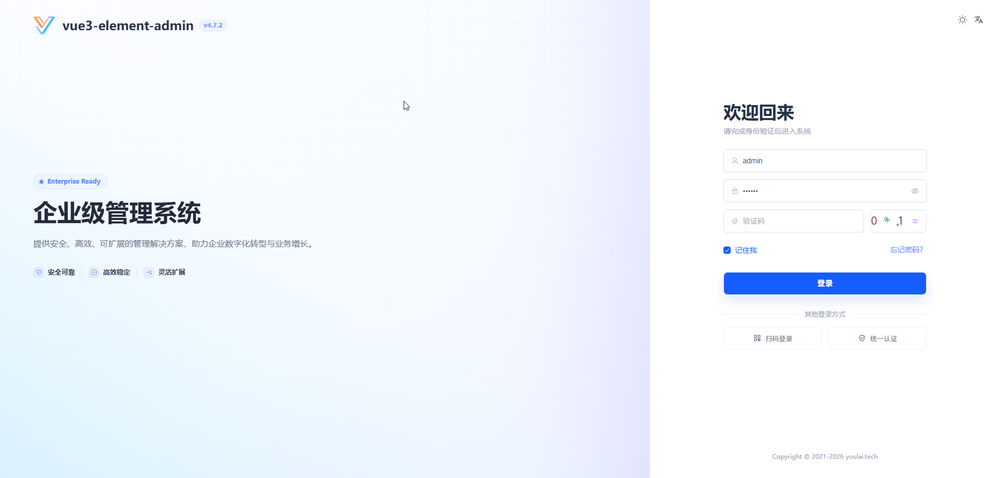
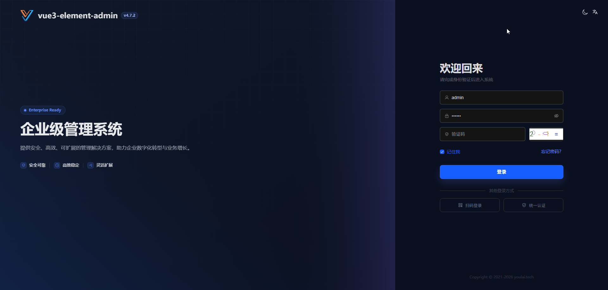
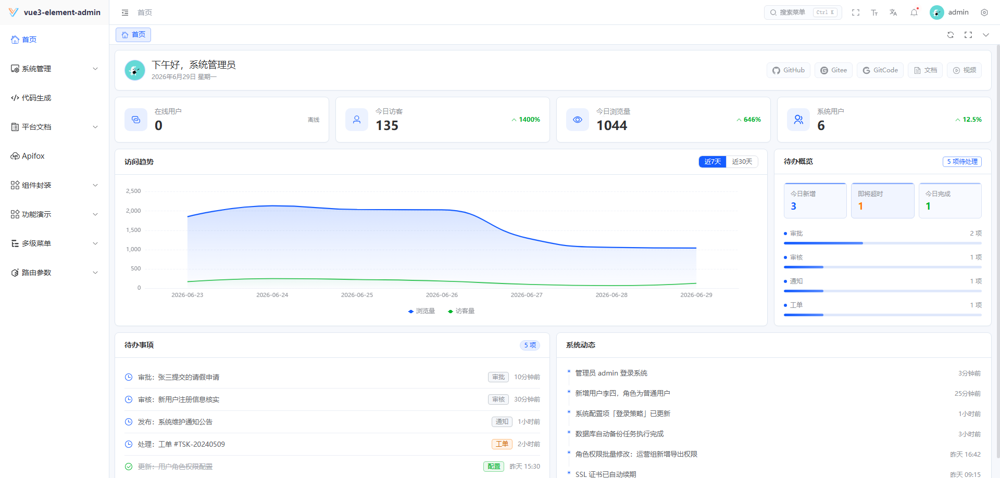
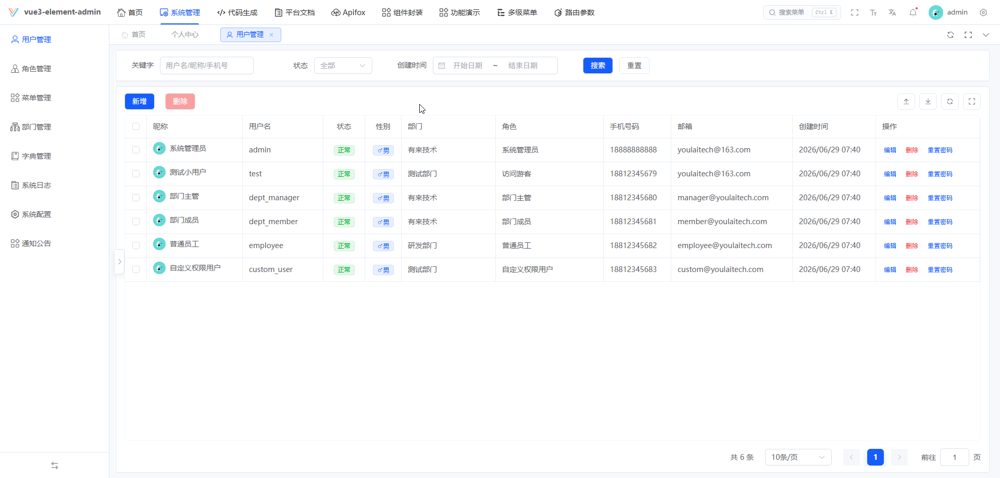
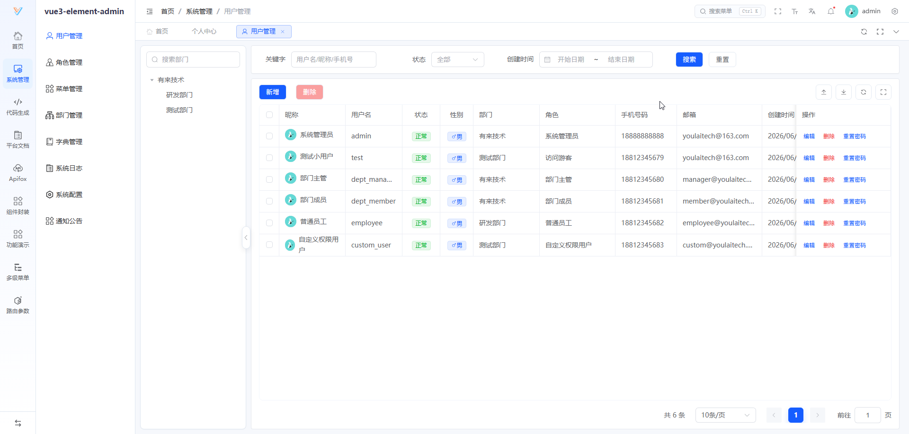
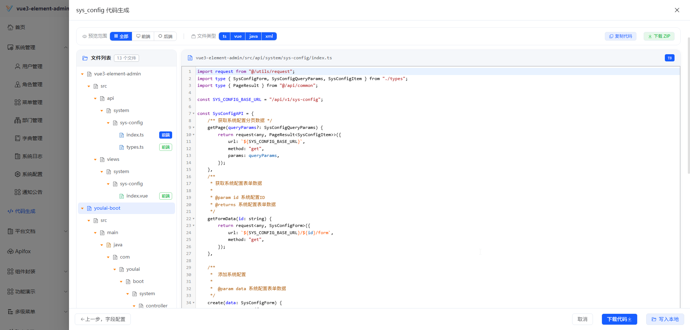
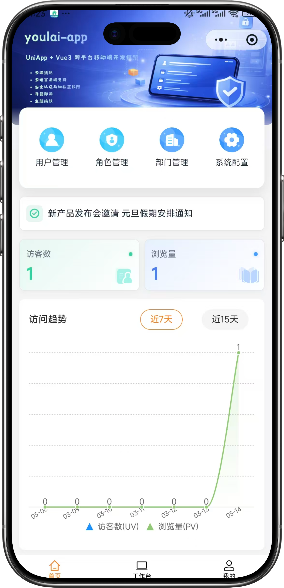
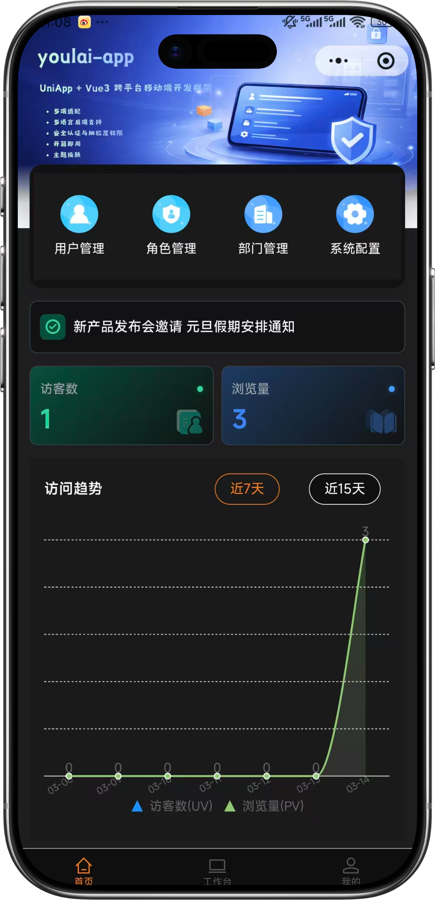
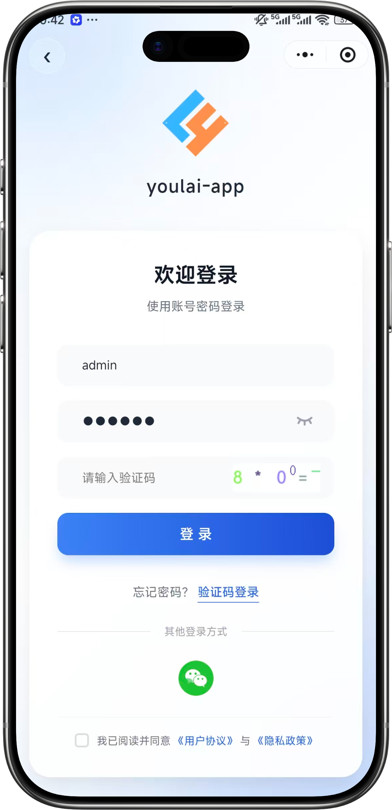
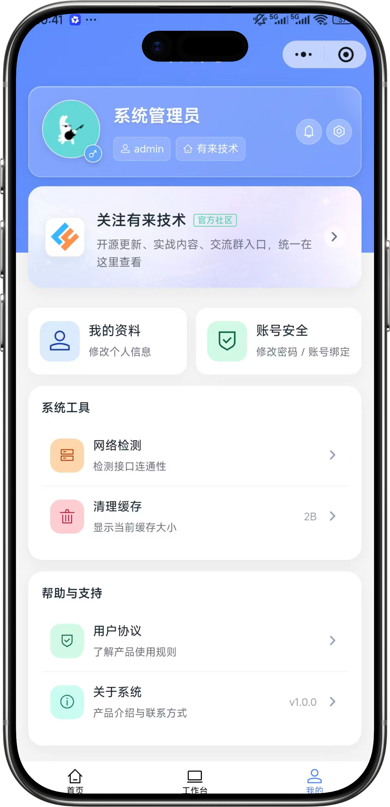

<div align="center">

#  youlai-boot

**Java 17 + Spring Boot 4.0.5 Enterprise-Grade Permission Management Backend**

[](https://spring.io/projects/spring-boot)
[](https://openjdk.org/)
[](LICENSE)
[](https://gitee.com/youlaiorg/youlai-boot/stargazers)
[](https://github.com/youlaitech/youlai-boot)
[](https://gitcode.com/youlai/youlai-boot/stargazers)

</div>

<p align="center"></p>

<div align="center">

[](https://admin.youlai.tech)
[](https://app.youlai.tech)
[](https://www.youlai.tech/docs/server/spring-boot/)
[](./README.md)

</div>

## Introduction

**youlai-boot** is an enterprise-grade permission management backend built on Spring Boot. It ships with the frontend [vue3-element-admin](https://gitee.com/youlaiorg/vue3-element-admin) and the mobile app [youlai-app](https://gitee.com/youlaiorg/youlai-app), and is one of **7 language implementations** (Java / Node.js / Go / Python / PHP / C# / Rust) that share the same API specification and database schema. It is suitable for learning, reference, and secondary development of enterprise admin systems.

## Core Features

- 🔐 **Security** — Spring Security + JWT/Redis Token formats, unified session management, token renewal, multi-device mutual exclusion

- 🔑 **Unified authentication (optional, disabled by default)** — [OIDC login](../docs/youlai-boot/oidc/implementation.md), delegates sign-in to an external identity provider and binds the authenticated account to a local user; nothing is loaded unless you enable it

- 🛡️ **Fine-grained permissions** — 5-level RBAC: data → menu → button → API → field

- ⚡ **Code generator** — one-click generation of full-stack CRUD code

- 📦 **Complete modules** — users, roles, menus, departments, dictionaries, files (OSS/RustFS/local), scheduled tasks, message center, operation logs

- 🔀 **Workflow** — Flowable approval flows: online BPMN design, conditional gateways, role-based approval, rejection & rollback

- 🌐 **Multi-tenant SaaS** — data isolation + tenant config, with a standalone [youlai-boot-tenant](https://gitee.com/youlaiorg/youlai-boot-tenant) edition

- 🔌 **Real-time communication** — WebSocket: one-time tickets, node presence, dictionary and notice updates

## System Preview

**PC**

<table align="center">
  <tr>
    <td></td>
    <td></td>
  </tr>
  <tr>
    <td></td>
    <td></td>
  </tr>
  <tr>
    <td></td>
    <td></td>
  </tr>
</table>

**Mobile**

<table align="center">
  <tr>
    <td></td>
    <td></td>
    <td></td>
    <td></td>
  </tr>
</table>

## Quick Start

**Requirements**: JDK 17+ · MySQL 8.0+ · Redis 6.0+

1. Clone the project:

   ```bash
   git clone https://gitee.com/youlaiorg/youlai-boot.git
   ```

2. Import the database:

   ```bash
   # Base schema (required)
   sql/youlai-admin.sql

   # Optional extensions: safe to skip, run after the base schema
   sql/extensions/dynamic-form.sql # Dynamic Form
   sql/extensions/workflow.sql     # Workflow (Flowable demo processes & demo accounts, not engine tables)
   sql/extensions/oidc.sql         # Unified authentication: app center menu & demo identity binding
   ```

   > Every extension script is **optional**. Users, roles, menus, dictionaries, logs and the code generator all live in `sql/youlai-admin.sql`; importing the base schema alone is enough to run the system.
   >
   > `oidc.sql` targets deployments with an existing identity provider. It adds the "App Center" menu and one demo identity binding. The backend switch `security.oidc.enabled` defaults to false. Enabling it requires an issuer, client ID, client secret, and frontend callback URI. The frontend login entry is controlled separately by `VITE_OIDC_ENABLED`. Skip this extension if you do not need single sign-on.

3. Check the development configuration and set the MySQL and Redis connections for your environment:

   ```bash
   src/main/resources/application-dev.yml
   ```

   Configuration is ordered by basic services, security and access, files and API documentation, then optional integrations. Start with the first half; email, SMS, mini programs, scheduled jobs, OIDC, AI, and workflow are grouped at the end. Sections separated by `---` belong to the same environment and load together.

   `application.yml` holds shared rules. `application-dev.yml` and `application-prod.yml` expose common settings and integration credentials. CAPTCHA appearance, session lifetimes, and connection pools use defaults; add properties only when you need to override them. The IDE provides descriptions and default values. Configure file upload storage and credentials in the `storage` section.

   Empty strings (`""`) in optional integrations mean not configured. Fill in your credentials when using the service, or leave the section alone. Email defaults to port 587 with SMTP authentication and STARTTLS; override these for other SMTP servers. The mini program provider defaults to `wechat-mini-main`. Set a new `wx.miniapp.provider` when replacing the AppID to avoid reusing existing identity bindings.

   For local use, fill in YAML directly. Deployments can override it with external configuration files or native Spring Boot environment variables, such as `WX_MINIAPP_APPID` and `SECURITY_OIDC_ENABLED`, without adding placeholders to YAML. [Variable naming rules](https://docs.spring.io/spring-boot/reference/features/external-config.html#features.external-config.typesafe-configuration-properties.relaxed-binding.environment-variables): replace dots with underscores, remove hyphens, and uppercase the name. Do not commit real credentials.

   Configure upload limits under `spring.servlet.multipart`; both the per-file and total request limits default to 50MB. When upgrading, migrate a custom `storage.upload.max-file-size` value to both `max-file-size` and `max-request-size`.

   Production SQL logging uses SLF4J and Logback. Temporarily set the relevant Mapper package to `DEBUG` when investigating SQL; the default `INFO` level does not print SQL debug logs.

4. Start the service:

   **Option 1: Run in IDEA (recommended)**
   Open the project in IDEA, wait for Maven dependencies to download, then run the application class `YouLaiBootApplication`.

   **Option 2: Command line**

   ```bash
   mvn spring-boot:run
   ```

   Once started, visit <http://localhost:8000/swagger-ui.html>. If the API docs open, the backend is running properly.

5. Start the frontend (optional):
   For a visual admin UI, start the companion frontend [vue3-element-admin](https://gitee.com/youlaiorg/vue3-element-admin), visit <http://localhost:3000>, and log in with `admin` / `123456`.

> For more details, see the official docs: [Quick Start](https://www.youlai.tech/docs/server/spring-boot/quick-start.html) · [Deployment Guide](https://www.youlai.tech/docs/server/spring-boot/deploy.html)

## Directory Structure

```
youlai-boot/
├── docs/                      # Docs and image assets
├── sql/                       # Database init scripts
├── src/                       # Source code
│   ├── auth/                  # Auth module
│   │   ├── password/          # Username/password login (with captcha)
│   │   ├── sms/               # SMS verification code login
│   │   ├── qrcode/            # QR code login
│   │   ├── wxma/              # WeChat Mini Program login
│   │   └── session/           # Session management (logout / token renewal)
│   ├── codegen/               # Code generator
│   ├── common/                # Common module (constants/enums/exceptions/response/utils)
│   ├── config/                # Configuration (Security/Redis/MyBatis/API docs/CORS/scheduling etc.)
│   ├── framework/             # Infrastructure layer
│   │   ├── mybatis/           # MyBatis-Plus config
│   │   ├── security/          # Spring Security
│   │   │   ├── config/        # Security config and properties
│   │   │   ├── filter/        # Token authentication filter
│   │   │   ├── handler/       # Authentication / authorization failure handlers
│   │   │   ├── model/         # Security model (SecurityUser / token / data scope)
│   │   │   ├── port/          # Auth & permission ports (implemented by system)
│   │   │   ├── service/       # User details and permission service
│   │   │   ├── token/         # Token management (JWT / Redis dual mode)
│   │   │   └── util/          # Security utilities
│   │   └── web/               # Web layer (global exception/CORS/rate limit)
│   ├── module/                # Business extension modules
│   │   ├── form/              # Dynamic Form
│   │   └── workflow/          # Workflow
│   ├── support/               # Capability services
│   │   ├── file/              # File storage (RustFS/Alibaba Cloud OSS/local)
│   │   ├── mail/              # Email service
│   │   ├── sms/               # SMS service
│   │   └── realtime/          # WebSocket communication
│   └── system/                # System business (user/role/menu/dept/dict etc.)
├── docker-compose.yml         # One-click middleware orchestration (MySQL/Redis/RustFS/Xxl-Job)
└── pom.xml                    # Maven dependency management
```

## Ecosystem

**Frontend**

| Project | Stack | Description | Status |
|:-----|:------|:------------|:---|
| [vue3-element-admin](https://gitee.com/youlaiorg/vue3-element-admin) | Vue 3 + Element Plus | PC admin frontend (recommended) | ✅️ |
| [youlai-app](https://gitee.com/youlaiorg/youlai-app) | Vue 3 + UniApp | Mobile App | ✅️ |

**Backend**

| Project | Stack | Description | Status |
|:-----|:------|:------------|:---|
| [youlai-boot](https://gitee.com/youlaiorg/youlai-boot) | Spring Boot + MyBatis-Plus | Java (recommended) | ✅️ |
| [youlai-nest](https://gitee.com/youlaiorg/youlai-nest) | NestJS + TypeORM | Node.js | ✅️ |
| [youlai-gin](https://gitee.com/youlaiorg/youlai-gin) | Go + Gorm | Go | ✅️ |
| [youlai-django](https://gitee.com/youlaiorg/youlai-django) | Django + DRF | Python | ✅️ |
| [youlai-fastapi](https://gitee.com/youlaiorg/youlai-fastapi) | FastAPI + SQLAlchemy | Python | ✅️ |
| [youlai-think](https://gitee.com/youlaiorg/youlai-think) | ThinkPHP + ThinkORM | PHP | ✅️ |
| [youlai-aspnet](https://gitee.com/youlaiorg/youlai-aspnet) | ASP.NET Core + EF Core | C# | ✅️ |
| [youlai-axum](https://gitee.com/youlaiorg/youlai-axum) | Axum + SeaORM | Rust | ✅️ |
| [youlai-laravel](https://gitee.com/youlaiorg/youlai-laravel) | Laravel + Eloquent | PHP | ❌️ |

> The nine backends share the same **RESTful API specification** and **database schema**, so the frontend can switch seamlessly.

**Derived Editions**

| Project | Based on | Type | Description | Status |
|:-----|:-----|:---|:------------|:---|
| [youlai-boot-tenant](https://gitee.com/youlaiorg/youlai-boot-tenant) | youlai-boot | Standalone repo | Multi-tenant SaaS with tenant isolation & config | ✅️ |
| [youlai-boot-flex](https://gitee.com/youlaiorg/youlai-boot-flex) | youlai-boot | Standalone repo | Built on MyBatis-Flex | ✅️ |
| [youlai-boot (db-pg)](https://gitee.com/youlaiorg/youlai-boot/tree/db-pg) | youlai-boot | Branch | PostgreSQL database branch | ✅️ |
| [youlai-boot (multi-module)](https://gitee.com/youlaiorg/youlai-boot/tree/multi-module) | youlai-boot | Branch | Multi-module project split | ✅️ |
| [youlai-nest (multi-tenant)](https://gitee.com/youlaiorg/youlai-nest/tree/multi-tenant) | youlai-nest | Branch | Multi-tenant SaaS with tenant isolation & config | ✅️ |
| [youlai-boot (spring-boot-3)](https://gitee.com/youlaiorg/youlai-boot/tree/spring-boot-3) | youlai-boot | Branch | Spring Boot 3 compatible branch | ❌️ |

## Optional Extensions

These are off by default.

**AI**: fill the key in the active profile and add `spring.ai.model.chat: openai`.

```yaml
spring:
  ai:
    model:
      chat: openai
    openai:
      base-url: https://dashscope.aliyuncs.com/compatible-mode/v1
      api-key: ""
      chat:
        model: qwen3.7-flash
        temperature: 0.3
        extra-body:
          "[enable_thinking]": false
```

**Workflow**: run the extension script to import menus, demo roles and forms (no `ACT_*` tables), then enable the switch in the active profile.

```bash
sql/extensions/workflow.sql
```

```yaml
flowable:
  process:
    enabled: true   # single switch for the module and the engine
  idm:
    enabled: false
  eventregistry:
    enabled: false
```

Development creates engine tables on startup; production needs them created first. Demo processes come from the reset action on the process model page.

**Single sign-on**: behind Nginx, uncomment `forward-headers-strategy: framework` in the profile's `server` block and make the proxy overwrite client `Forwarded` / `X-Forwarded-*` headers.

**Multi-tenant**: see [youlai-boot-tenant](https://gitee.com/youlaiorg/youlai-boot-tenant).

## License & Support

This project is open-sourced under the [Apache License 2.0](LICENSE) and free for commercial use. Feel free to submit [issues](https://gitee.com/youlaiorg/youlai-boot/issues) or feedback, and pull requests are always welcome.

For technical support, business cooperation, secondary development, project customization, or private deployment, contact the author on WeChat (QR codes below).

<table align="center">
  <tr>
    <td align="center">
      <br>
      <sub>Official WeChat Account</sub>
    </td>
    <td>&nbsp;&nbsp;&nbsp;&nbsp;</td>
    <td align="center">
      <br>
      <sub>Mini Program</sub>
    </td>
    <td>&nbsp;&nbsp;&nbsp;&nbsp;</td>
    <td align="center">
      <br>
      <sub>Add author on WeChat</sub>
    </td>
  </tr>
</table>

<p align="center"><em>Technical discussion · Feedback · Business cooperation</em></p>
