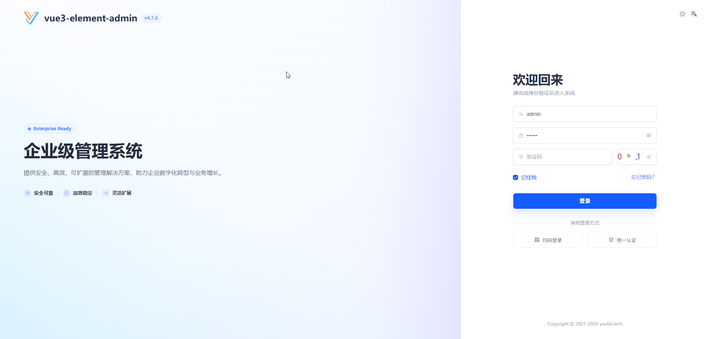
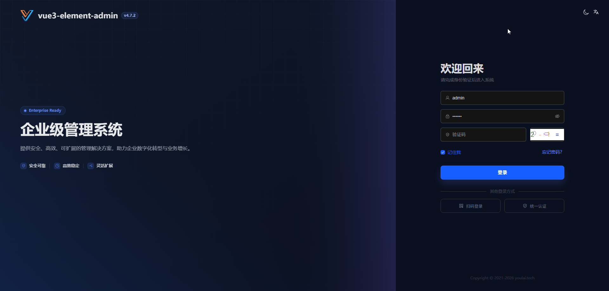
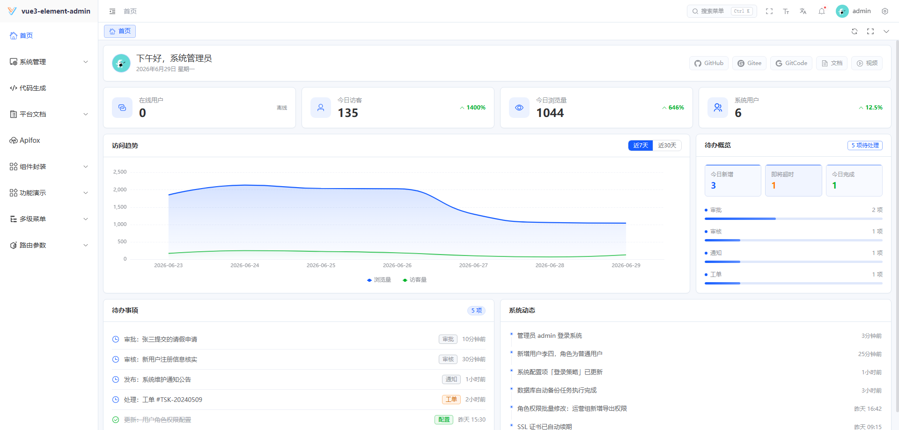
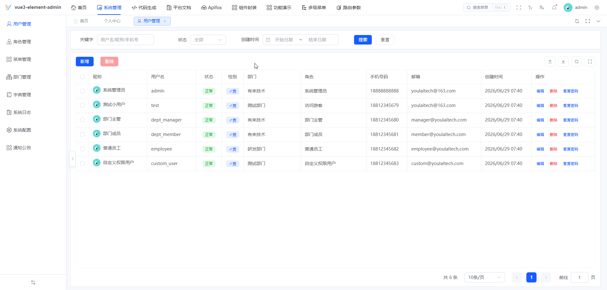
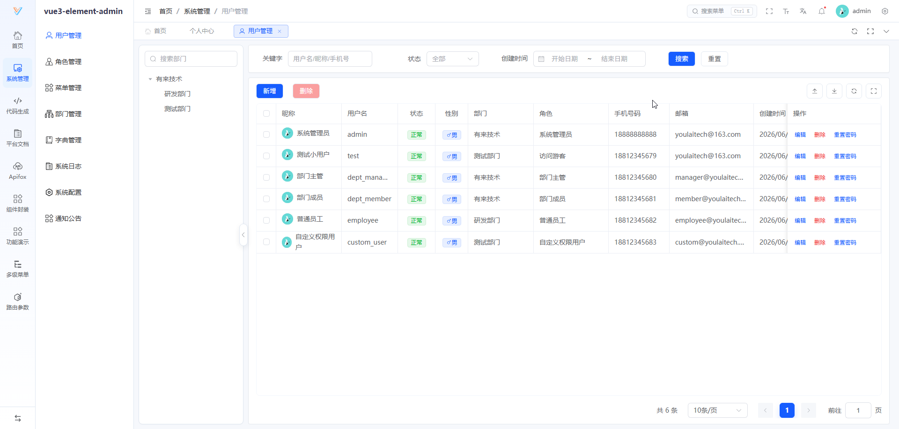
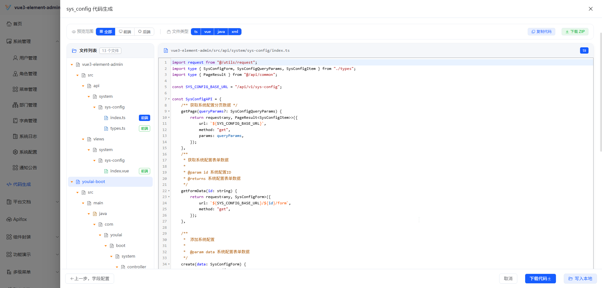
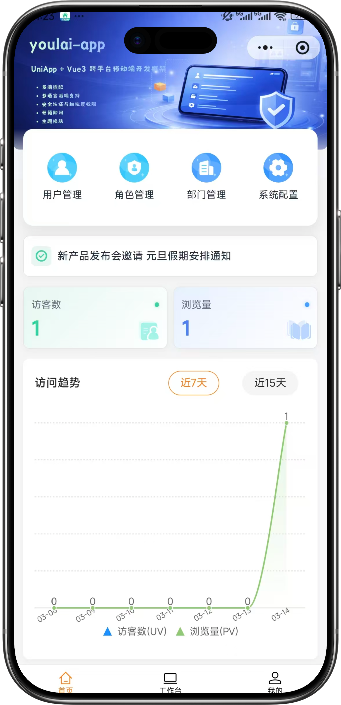
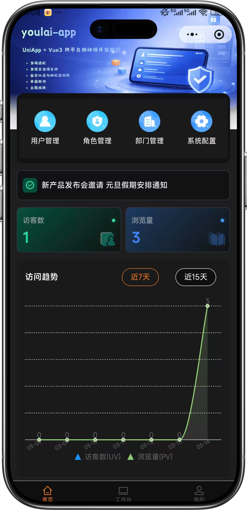
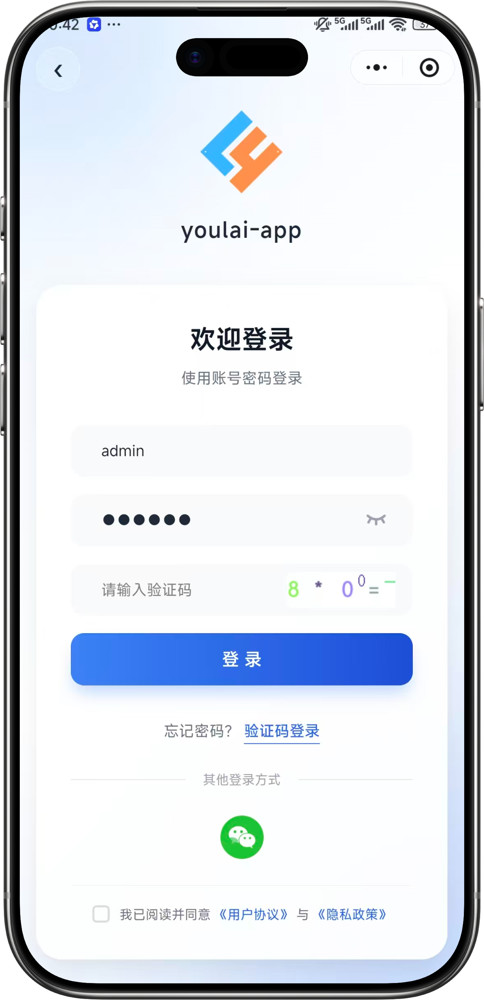
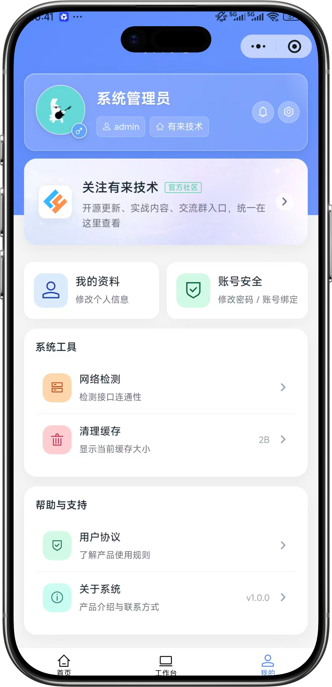

<div align="center">

#  youlai-boot

**Java 17 + Spring Boot 4.0.5 企业级权限管理系统后端**

[](https://spring.io/projects/spring-boot)
[](https://openjdk.org/)
[](LICENSE)
[](https://gitee.com/youlaiorg/youlai-boot/stargazers)
[](https://github.com/youlaitech/youlai-boot)
[](https://gitcode.com/youlai/youlai-boot/stargazers)

</div>

<p align="center"></p>

<div align="center">

[](https://admin.youlai.tech)
[](https://app.youlai.tech)
[](https://www.youlai.tech/docs/server/spring-boot/)
[](./README.en.md)

</div>

## 项目简介

**youlai-boot** 是一套基于 Spring Boot 的企业级权限管理系统后端，配套前端 [vue3-element-admin](https://gitee.com/youlaiorg/vue3-element-admin) 和移动端 [youlai-app](https://gitee.com/youlaiorg/youlai-app)，并提供 **7 种语言实现**（Java / Node.js / Go / Python / PHP / C# / Rust），共享同一套 API 规范与数据库结构。适用于企业中后台管理系统的学习参考与二次开发。

## 核心特性

- 🔐 **安全体系** — Spring Security + JWT/Redis Token 两种令牌格式、统一会话管理、令牌续期、多端互斥

- 🔑 **统一认证（可选，默认关闭）** — [OIDC 登录](../docs/youlai-boot/oidc/implementation.md)，把登录交给外部认证中心，认证成功后关联本地用户并复用角色权限；不启用就不会加载相关组件

- 🛡️ **细粒度权限** — RBAC 五级：数据 → 菜单 → 按钮 → 接口 → 字段

- ⚡ **代码生成器** — 一键生成前后端 CRUD 代码

- 📦 **模块齐全** — 用户、角色、菜单、部门、字典、文件(OSS/RustFS/本地)、定时任务、消息中心、操作日志

- 🔀 **工作流** — Flowable 审批流：BPMN 在线设计、条件网关、角色审批、驳回回退

- 🌐 **多租户 SaaS** — 数据隔离 + 租户配置，独立 [youlai-boot-tenant](https://gitee.com/youlaiorg/youlai-boot-tenant) 版本

- 🔌 **实时通信** — [WebSocket 接入](../docs/youlai-boot/realtime.md)：一次性票据鉴权、节点在线人数、字典同步、通知提示

## 系统预览

**PC 端**

<table align="center">
  <tr>
    <td></td>
    <td></td>
  </tr>
  <tr>
    <td></td>
    <td></td>
  </tr>
  <tr>
    <td></td>
    <td></td>
  </tr>
</table>

**移动端**

<table align="center">
  <tr>
    <td></td>
    <td></td>
    <td></td>
    <td></td>
  </tr>
</table>

## 快速开始

**环境要求**：JDK 17+ · MySQL 8.0+ · Redis 6.0+

1. 克隆项目：

   ```bash
   git clone https://gitee.com/youlaiorg/youlai-boot.git
   ```

2. 导入数据库：

   ```bash
   # 基础库（必装）
   sql/youlai-admin.sql

   # 可选扩展：不装不影响基础功能，需在基础库之后执行
   sql/extensions/dynamic-form.sql # 动态表单
   sql/extensions/workflow.sql   # 工作流（Flowable 演示流程与演示账号，非引擎表）
   sql/extensions/oidc.sql        # 统一认证：应用中心菜单与演示身份关联
   ```

3. 检查开发配置，按实际环境填写 MySQL、Redis 连接信息：

   ```bash
   src/main/resources/application-dev.yml
   ```

4. 启动服务：

   **方式一：IDEA 启动（推荐）**
   用 IDEA 打开项目，等待 Maven 依赖下载完成，运行启动类 `YouLaiBootApplication` 即可。

   **方式二：命令行启动**

   ```bash
   mvn spring-boot:run
   ```

   启动后访问 <http://localhost:8000/swagger-ui.html>，能打开接口文档即说明后端已正常运行。

5. 启动前端（可选）：
   如需可视化操作界面，启动配套前端 [vue3-element-admin](https://gitee.com/youlaiorg/vue3-element-admin)，访问 <http://localhost:3000>，使用 `admin` / `123456` 登录。

> 更多内容详见官方文档：[快速开始](https://www.youlai.tech/docs/server/spring-boot/quick-start.html) · [部署指南](https://www.youlai.tech/docs/server/spring-boot/deploy.html)


## 目录结构

```
youlai-boot/
├── docs/                      # 项目文档与图片资源
├── sql/                       # 数据库初始化脚本
├── src/                       # 源码目录
│   ├── auth/                  # 认证模块
│   │   ├── password/          # 账号密码登录（含图形验证码）
│   │   ├── sms/               # 短信验证码登录
│   │   ├── qrcode/            # 扫码登录
│   │   ├── wxma/              # 微信小程序登录
│   │   └── session/           # 登录态管理（登出 / 刷新令牌）
│   ├── codegen/               # 代码生成器
│   ├── common/                # 公共模块（常量/枚举/异常/统一响应/工具类）
│   ├── config/                # 配置类（Security/Redis/MyBatis/接口文档/跨域/定时任务等）
│   ├── framework/             # 基础设施层
│   │   ├── mybatis/           # MyBatis-Plus 配置
│   │   ├── security/          # Spring Security
│   │   │   ├── config/        # 安全配置与配置属性
│   │   │   ├── filter/        # Token 认证过滤器
│   │   │   ├── handler/       # 认证 / 授权失败处理器
│   │   │   ├── model/         # 安全模型（SecurityUser / 令牌 / 数据范围）
│   │   │   ├── port/          # 认证与权限端口（由 system 提供实现）
│   │   │   ├── service/       # 用户详情与权限服务
│   │   │   ├── token/         # Token 管理（JWT / Redis 双模式）
│   │   │   └── util/          # 安全工具类
│   │   └── web/               # Web 层（全局异常/跨域/限流）
│   ├── module/                # 业务扩展模块
│   │   ├── form/              # 动态表单
│   │   └── workflow/          # 工作流
│   ├── support/               # 能力服务
│   │   ├── ai/                # AI 对话（代码生成/动态表单/工作流辅助，默认关闭）
│   │   ├── file/              # 文件存储（RustFS/阿里云OSS/本地）
│   │   ├── mail/              # 邮件服务
│   │   ├── sms/               # 短信服务
│   │   └── realtime/          # WebSocket 实时通信
│   └── system/                # 系统业务（用户/角色/菜单/部门/字典等）
├── docker-compose.yml         # 中间件一键编排（MySQL/Redis/RustFS/Xxl-Job）
└── pom.xml                    # Maven 依赖管理
```

## 生态矩阵

**前端**

| 项目                                                                   | 技术栈                  | 说明          | 更新状态 |
| :------------------------------------------------------------------- | :------------------- | :---------- | :--- |
| [vue3-element-admin](https://gitee.com/youlaiorg/vue3-element-admin) | Vue 3 + Element Plus | PC 管理前端（主推） | ✅️   |
| [youlai-app](https://gitee.com/youlaiorg/youlai-app)                 | Vue 3 + UniApp       | 移动端 App     | ✅️   |

**后端**

| 项目                                                           | 技术栈                        | 说明       | 更新状态 |
| :----------------------------------------------------------- | :------------------------- | :------- | :--- |
| [youlai-boot](https://gitee.com/youlaiorg/youlai-boot)       | Spring Boot + MyBatis-Plus | Java（主推） | ✅️   |
| [youlai-nest](https://gitee.com/youlaiorg/youlai-nest)       | NestJS + TypeORM           | Node.js  | ✅️   |
| [youlai-gin](https://gitee.com/youlaiorg/youlai-gin)         | Go + Gorm                  | Go       | ✅️   |
| [youlai-django](https://gitee.com/youlaiorg/youlai-django)   | Django + DRF               | Python   | ✅️   |
| [youlai-fastapi](https://gitee.com/youlaiorg/youlai-fastapi) | FastAPI + SQLAlchemy       | Python   | ✅️   |
| [youlai-think](https://gitee.com/youlaiorg/youlai-think)     | ThinkPHP + ThinkORM        | PHP      | ✅️   |
| [youlai-aspnet](https://gitee.com/youlaiorg/youlai-aspnet)   | ASP.NET Core + EF Core     | C#       | ✅️   |
| [youlai-axum](https://gitee.com/youlaiorg/youlai-axum)       | Axum + SeaORM              | Rust     | ✅️   |
| [youlai-laravel](https://gitee.com/youlaiorg/youlai-laravel) | Laravel + Eloquent         | PHP      | ✅️   |

> 九种后端共享同一套 **RESTful API 规范** 和 **数据库结构**，前端可无缝切换。

**衍生版本**

| 项目                                                                                        | 基于          | 类型   | 说明                 | 更新状态 |
| :---------------------------------------------------------------------------------------- | :---------- | :--- | :----------------- | :--- |
| [youlai-boot-tenant](https://gitee.com/youlaiorg/youlai-boot-tenant)                      | youlai-boot | 独立仓库 | 多租户 SaaS，租户隔离与租户配置 | ✅️   |
| [youlai-boot-flex](https://gitee.com/youlaiorg/youlai-boot-flex)                          | youlai-boot | 独立仓库 | 改用 MyBatis-Flex    | ✅️   |
| [youlai-boot (db-pg)](https://gitee.com/youlaiorg/youlai-boot/tree/db-pg)                 | youlai-boot | 分支   | PostgreSQL 数据库分支   | ✅️   |
| [youlai-boot (multi-module)](https://gitee.com/youlaiorg/youlai-boot/tree/multi-module)   | youlai-boot | 分支   | 多模块工程拆分            | ✅️   |
| [youlai-nest (multi-tenant)](https://gitee.com/youlaiorg/youlai-nest/tree/multi-tenant)   | youlai-nest | 分支   | 多租户 SaaS，租户隔离与租户配置 | ✅️   |
| [youlai-boot (spring-boot-3)](https://gitee.com/youlaiorg/youlai-boot/tree/spring-boot-3) | youlai-boot | 分支   | Spring Boot 3 兼容分支 | ✅️   |

## 可选扩展

以下功能默认关闭，需要时再开启。

### AI 辅助

在当前环境配置中填写密钥，并加上 `spring.ai.model.chat: openai`。

```yaml
spring:
  ai:
    model:
      chat: openai
    openai:
      base-url: https://dashscope.aliyuncs.com/compatible-mode/v1
      api-key: ""
      chat:
        model: qwen3.7-flash
```

### 工作流

执行 `sql/extensions/workflow.sql` 导入菜单、演示角色与发起表单（不含 `ACT_*` 引擎表），再在环境配置中打开开关：

```yaml
flowable:
  process:
    enabled: true   # 唯一开关，同时控制业务模块和引擎
```

### 统一认证

OIDC 登录接入外部认证中心，见[统一认证](https://www.youlai.tech/docs/server/spring-boot/modules-oidc.html)。

### 多租户

见[多租户](https://www.youlai.tech/docs/server/spring-boot/modules-multi-tenant.html)。

## 技术合作

本项目采用 [Apache License 2.0](LICENSE) 开源，可免费商用。欢迎在 [Issue](https://gitee.com/youlaiorg/youlai-boot/issues) 提交问题或反馈，也欢迎提交 [Pull Request](https://gitee.com/youlaiorg/youlai-boot/pulls) 共建。

如需技术支持、商务合作、二次开发、项目定制或私有化部署，可联系作者微信（见下方二维码）。

<table align="center">
  <tr>
    <td align="center">
      <br>
      <sub>公众号「有来技术」</sub>
    </td>
    <td>&nbsp;&nbsp;&nbsp;&nbsp;</td>
    <td align="center">
      <br>
      <sub>小程序「有来技术」</sub>
    </td>
    <td>&nbsp;&nbsp;&nbsp;&nbsp;</td>
    <td align="center">
      <br>
      <sub>添加作者微信</sub>
    </td>
  </tr>
</table>

<p align="center"><em>技术交流 · 问题反馈 · 商务合作</em></p>
