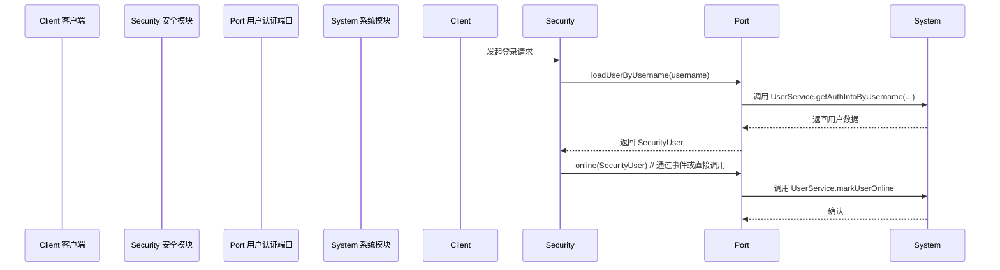

<!--
  本文档已合并至 security-refactor-plan.md（v2.1，2026-07-04）。
  合并后的文档包含：模型消除（UserAuthInfo→SecurityUser 重命名） + 端口/适配器解耦 + 单模块/多模块实施教程 + Security Starter 抽离实操 + Maven Central 发布 + youlai-starter 独立仓库 + AI 协作指南。
  本文档保留作为历史参考，不再维护。
  请前往：security-refactor-plan.md
-->

# 概要（已归档）

> **本文档已于 2026-07-04 完整合并至 `security-refactor-plan.md`（v2.1）。**
>
> 合并时进行的去重处理：
> - 虚构模型 `SecurityUser` → 统一使用实际存在的 `UserAuthInfo`
> - 4 端口方案 → 精简为 2 核心端口（`UserAuthenticationPort`、`PermissionPort`）+ 1 可选扩展（`OnlineUserPort`，移至附录）
> - `RolePort` 删除（roles 已包含在 `UserAuthInfo` 中，单独端口冗余）
> - 重复的 Ports & Adapters 模式介绍 → 精简为第二节 2.1
> - 重复的迁移步骤/代码审查清单 → 合并至统一章节
>
> 以下为原始内容，仅供历史参考。

---

当前 `framework/security` 模块直接依赖 `system` 模块的用户、角色等服务，实现登录认证和权限校验。比如 `SecurityUserDetailsService` 中通过 `UserService.getAuthInfoByUsername(...)` 获取用户认证信息，并使用 `SecurityUserDetails` 包装返回；还引入了 `UserSocialService` 等系统服务。这种实现导致安全模块与系统模块耦合度极高，不利于后续模块化或替换。按照 Ports & Adapters（六边形架构）原则，**应将安全模块对系统模块的调用抽象为接口（Port）**，在系统模块提供对应的实现（Adapter）。这样安全模块只依赖接口，而不直接引用系统实体或服务，实现内核业务与外部实现的解耦。下文给出全面的重构设计：定义清晰的包结构、接口（Port）命名规范、适配器实现示例、事件设计、自动装配等，并通过对比表、迁移步骤和测试/审查清单详细说明改动原因与风险。

**主要改进**：将原来直接使用 `UserService`/`UserSocialService` 等系统服务的逻辑，迁移到新的接口调用上。以 `UserAuthenticationPort`、`PermissionPort`、`RolePort`、`OnlineUserPort` 等抽象端口替代 `SecurityUserDetailsService` 中的调用；在系统模块中提供适配器实现；修改原认证/权限代码使用这些端口接口，从而使安全模块与系统模块仅通过抽象接口交互，实现松耦合和更高的可测试性。

# 现状 vs 建议（关键点比较）

|  对比维度   | **当前实现（耦合严重）** | **建议实现（使用 Ports & Adapters）** |
|-----------|-------------------------|---------------------------------------|
| **依赖关系**  | `framework/security` 直接依赖 `system` 模块的实体和服务。<br>代码中大量 `import com.youlai.boot.system.*`。 | 安全模块仅引用自身定义的接口（Port），不再直接 `import system`。系统模块实现这些接口并注入。<br>安全模块不直接依赖系统实体，只通过抽象调用。 |
| **用户认证**  | 在 `SecurityUserDetailsService` 中通过 `UserService` 查询用户认证数据。 | 定义 `UserAuthenticationPort` 接口（`loadUserByUsername`），由系统侧适配器实现。`SecurityUserDetailsService` 调用该接口获得用户信息。 |
| **角色权限**  | `SecurityUserDetails` 构造时直接使用 `UserAuthInfo.getRoles()`等；权限校验使用 `PermissionService`（注入 `RoleMenuService`）动态获取权限集合。 | 定义 `RolePort`、`PermissionPort` 接口，分别提供用户角色、用户权限查询方法。系统模块通过查询角色表、角色-权限表等实现。安全模块使用端口获取角色/权限。 |
| **在线用户**  | 无专门接口；若记录在线用户，需要手动在登录逻辑中调用系统服务。 | 定义 `OnlineUserPort` 接口，在登录成功/退出时由安全模块发布事件调用该接口（示例：`online(SecurityUser user)`，`offline(Long userId)`）。系统侧实现可记录用户登录状态或统计。 |
| **命名规范**  | 普通 Service 命名（`XxxService`、`XxxServiceImpl`）；未区分 Ports/Adapters 概念。 | 端口接口统一以 `Port` 结尾，如 `UserAuthenticationPort`、`PermissionPort` 等；适配器类可以 `Adapter` 或 `ServiceImpl` 后缀。符合常见 *hexagonal* 实践。 |
| **包结构**   | 安全模块代码散落在 `security.service`、`security.model` 等包中，与业务服务混合。 | 建议在安全模块新增 `security.port` 包放置接口，或置于 `security.service` 目录下；系统模块新增 `adapter` 包放置实现。逻辑清晰分层。 |
| **测试可控**  | 安全代码测试需要引入系统服务（耦合高）。 | 安全逻辑可针对 Port 接口单元测试（使用模拟实现），系统实现也可单独测试。解耦后更易覆盖测试。 |
| **演进灵活**  | 更换系统或提取模块成本高。 | 通过实现不同的 Port 适配器，可灵活替换系统实现；后续拆分为 Starter 模式时，只需发布 Port 接口和依赖注入方案。 |

# Ports & Adapters 模式简介

**六边形架构（Ports & Adapters）**模式提出应用核心业务逻辑通过抽象的"端口（Port）"与外部通信，实现对外界依赖的隔离。外部实现（如数据库、Web 服务、其他模块）通过具体的适配器（Adapter）连入端口。通俗地说，将原本直接调用的外部组件封装为接口（Port），核心业务只依赖接口而非具体实现；在外围提供实现类（Adapter）注入接口。此模式不是 GOF 中的"23 种设计模式"之一，而是一种架构模式，常被称为**六边形架构**或**Hexagonal Architecture**。

在 Spring Boot 项目中，可将安全模块核心逻辑看作"内部六边形"，定义各类服务所需的接口（Ports），而系统模块提供对应实现。例如：

- **端口（Port）接口**：定义安全模块需要的功能，如加载用户信息、查询权限、角色等。接口可使用 `Port` 后缀命名以示区分（`UserAuthenticationPort`、`PermissionPort`、`RolePort`、`OnlineUserPort`）。
- **适配器（Adapter）实现**：在系统模块中实现上述接口，内部调用 `UserService`、`RoleService`、`RoleMenuService` 等具体服务，将数据转换成安全模块期望的格式。使用 `@Component` 等注解注入 Spring 容器。
- **解耦效果**：安全模块只在编译期看到接口，不持有系统包的任何引用，大幅降低耦合。系统模块可自行修改实现细节或拆分发布，只要契合接口契约即可。

例如，下述接口定义了登录认证所需的端口：

```java
package com.youlai.boot.security.port;

/**
 * 用户认证接口 (Port).
 * 由系统模块提供实现，用于根据用户名加载用户安全信息。
 */
public interface UserAuthenticationPort {

    /**
     * 根据用户名加载用户认证信息（包含用户名、密码、启用状态、角色列表等）。
     *
     * @param username 用户名
     * @return 包含用户认证信息的SecurityUser对象，如果用户不存在可返回null或抛出异常
     * @throws UsernameNotFoundException 如果未找到用户
     */
    SecurityUser loadUserByUsername(String username) throws UsernameNotFoundException;
}
```

同理，可定义获取权限和角色的接口（示例）：

```java
package com.youlai.boot.security.port;

/**
 * 权限查询接口 (Port).
 * 提供获取指定用户权限集合的方法。
 */
public interface PermissionPort {
    /**
     * 获取指定用户 ID 的权限字符串集合。
     *
     * @param userId 用户ID
     * @return 权限字符串集合，如"user:list", "order:detail"等
     */
    Set<String> getPermissions(Long userId);
}

/**
 * 角色查询接口 (Port).
 * 提供获取指定用户角色集合的方法。
 */
public interface RolePort {
    /**
     * 获取指定用户 ID 的角色标识集合。
     *
     * @param userId 用户ID
     * @return 角色编码集合，如"ADMIN", "USER"等
     */
    Set<String> getRoles(Long userId);
}

/**
 * 在线用户通知接口 (Port).
 * 用户登录登出时用于通知系统模块记录在线状态。
 */
public interface OnlineUserPort {
    /**
     * 用户上线通知，登录认证成功后调用。
     * @param user 登录成功的安全用户信息
     */
    void online(SecurityUser user);

    /**
     * 用户下线通知，可在登出或 token 失效时调用。
     * @param userId 用户ID
     */
    void offline(Long userId);
}
```

以上接口（Ports）只属于安全模块，无系统包引用。接口命名使用了 `Port` 后缀，这是一种常见约定，用于区分业务接口与基础设施实现。**命名规范**上，接口名应精确描述业务功能，遵循驼峰式命名，端口名称以英文名词加上"Port"后缀，如 `UserAuthenticationPort`；实现类可名为 `SystemUserAuthenticationAdapter` 或 `UserAuthenticationAdapterImpl` 等，并标记为 Spring 的组件（`@Component`）。

# 包结构与端口定义

重构后的建议包结构示例如下（省略部分不相关包）：

```
com.youlai.boot.security
├── config/          # 安全模块配置（如 WebSecurity 配置等）
├── port/            # 定义端口接口（Ports）
│   ├── UserAuthenticationPort.java
│   ├── PermissionPort.java
│   ├── RolePort.java
│   └── OnlineUserPort.java
├── service/         # 安全模块内部服务实现（仅业务逻辑，无系统依赖）
│   ├── SecurityUserDetailsService.java   # 实现 UserDetailsService，调用 Port 接口
│   └── ...         # 其他认证服务
├── handler/         # 异常、结果处理器等
├── filter/          # 安全过滤器，如 JWT 过滤等
├── model/           # 安全模块领域模型，如 SecurityUser、UserSession 等
└── ...             # 其他安全相关包
com.youlai.boot.system
└── adapter/         # 系统模块中的适配器实现
    ├── UserAuthenticationAdapter.java   # 实现 UserAuthenticationPort
    ├── PermissionAdapter.java           # 实现 PermissionPort
    ├── RoleAdapter.java                 # 实现 RolePort
    ├── OnlineUserAdapter.java           # 实现 OnlineUserPort
    └── ...
```

其中，`com.youlai.boot.security.model.SecurityUser` 是我们自定义的安全用户模型，包含用户ID、用户名、密码、启用状态、角色、权限等字段，用于端口接口返回（可参考 `UserAuthInfo`）。安全核心逻辑不直接使用 `com.youlai.boot.system.model.entity.*`，而是使用自己的 `SecurityUser` 或相似 DTO。SecurityUserDetails 的构造可改为接受 `SecurityUser`。

### 接口（Port）定义

以登录认证为例，`UserAuthenticationPort` 接口定义如下：

```java
package com.youlai.boot.security.port;

import org.springframework.security.core.userdetails.UsernameNotFoundException;

/**
 * 用户认证端口（Port）。
 * Security 模块通过此接口加载用户认证信息，由系统模块提供实现。
 */
public interface UserAuthenticationPort {

    /**
     * 根据用户名加载用户安全信息，包括用户名、密码、启用状态、角色列表等。
     *
     * @param username 用户名
     * @return 包含用户认证数据的 SecurityUser 对象
     * @throws UsernameNotFoundException 用户不存在时抛出
     */
    SecurityUser loadUserByUsername(String username) throws UsernameNotFoundException;
}
```

类似地，`PermissionPort`、`RolePort`、`OnlineUserPort` 接口如前所示。所有接口方法应带有清晰的 Javadoc 注释，说明参数和返回值（或异常）。方法命名使用动词开头，如 `getPermissions`、`getRoles`、`online`、`offline`，与团队命名规范一致。返回类型避免使用系统实体类，而是安全模块自己的模型或基础类型。

# 适配器实现示例

在系统模块中实现上述接口。适配器需标注为 Spring 组件（如 `@Component`），以便自动注入。示例：

```java
package com.youlai.boot.system.adapter;

import com.youlai.boot.security.model.SecurityUser;
import com.youlai.boot.security.port.UserAuthenticationPort;
import com.youlai.boot.system.service.UserService;
import org.springframework.beans.factory.annotation.Autowired;
import org.springframework.security.core.userdetails.UsernameNotFoundException;
import org.springframework.stereotype.Component;

/**
 * 系统用户适配器，实现安全模块的 UserAuthenticationPort。
 */
@Component
public class UserAuthenticationAdapter implements UserAuthenticationPort {

    @Autowired
    private UserService userService;

    @Override
    public SecurityUser loadUserByUsername(String username) throws UsernameNotFoundException {
        // 调用系统服务获取用户认证信息（可能包括用户实体、角色列表等）
        var userAuthInfo = userService.getAuthInfoByUsername(username);
        if (userAuthInfo == null) {
            throw new UsernameNotFoundException("用户名不存在: " + username);
        }
        // 将系统返回的数据转换为安全模块的 SecurityUser
        SecurityUser user = new SecurityUser();
        user.setUserId(userAuthInfo.getUserId());
        user.setUsername(userAuthInfo.getUsername());
        user.setPassword(userAuthInfo.getPassword());
        user.setEnabled(userAuthInfo.getStatus() == 1);
        user.setDeptId(userAuthInfo.getDeptId());
        user.setRoles(userAuthInfo.getRoles());
        // 如果需要，也可以在此填充用户权限
        return user;
    }
}
```

在上例中，**`UserAuthenticationAdapter` 实现了 `UserAuthenticationPort`**，在调用时系统模块可直接注入此类。它内部调用原来的 `UserService.getAuthInfoByUsername`，然后将数据封装为安全模块领域的 `SecurityUser`。如此，安全模块再也无需直接引用 `com.youlai.boot.system` 包，只关心接口和 `SecurityUser` 类型。

权限、角色适配器示例（系统模块）：

```java
package com.youlai.boot.system.adapter;

import com.youlai.boot.security.port.PermissionPort;
import com.youlai.boot.security.port.RolePort;
import com.youlai.boot.system.service.RoleMenuService;
import com.youlai.boot.system.service.UserService;
import org.springframework.beans.factory.annotation.Autowired;
import org.springframework.stereotype.Component;

import java.util.Set;

/**
 * 系统权限/角色适配器。
 */
@Component
public class PermissionAndRoleAdapter implements PermissionPort, RolePort {

    @Autowired
    private RoleMenuService roleMenuService; // 系统服务，用于获取角色权限

    @Autowired
    private UserService userService; // 系统服务，用于获取用户角色

    @Override
    public Set<String> getRoles(Long userId) {
        // 调用系统服务查询用户角色标识列表（需实现此方法或自行查询用户角色关联表）
        return userService.getUserRoleCodes(userId);
    }

    @Override
    public Set<String> getPermissions(Long userId) {
        // 根据用户角色获取权限列表（类似原有 PermissionService 逻辑）
        Set<String> roles = getRoles(userId);
        if (roles == null || roles.isEmpty()) {
            return Set.of();
        }
        // roleMenuService.getRolePermsByRoleCodes 返回角色对应的菜单/权限标识
        return roleMenuService.getRolePermsByRoleCodes(roles);
    }
}
```

注意：上述代码假定 `UserService` 提供 `getUserRoleCodes(userId)` 方法来返回用户拥有的角色编码集合；如果没有，需自行查询 `sys_user_role` 表并结合 `SysRole` 表获取。`RoleMenuService.getRolePermsByRoleCodes(roles)` 方法则返回对应角色的所有权限字符串。这些实现细节可根据系统模块已有功能调整，但**接口契约应保证返回安全模块期望的格式**。

`OnlineUserPort` 的实现示例：当用户登录或退出时，安全模块可发布事件（详见下一节）由适配器捕获并执行，比如记录在线用户或更新登录时间：

```java
package com.youlai.boot.system.adapter;

import com.youlai.boot.security.model.SecurityUser;
import com.youlai.boot.security.port.OnlineUserPort;
import com.youlai.boot.system.service.UserService;
import org.springframework.beans.factory.annotation.Autowired;
import org.springframework.stereotype.Component;

/**
 * 在线用户适配器，实现上线/下线通知。
 */
@Component
public class OnlineUserAdapter implements OnlineUserPort {

    @Autowired
    private UserService userService;

    @Override
    public void online(SecurityUser user) {
        // 系统记录用户上线事件（例如保存用户最后登录时间、标记在线状态）
        userService.markUserOnline(user.getUserId());
    }

    @Override
    public void offline(Long userId) {
        // 系统记录用户下线事件
        userService.markUserOffline(userId);
    }
}
```

其中 `markUserOnline/markUserOffline` 需在系统模块实现，可简单更新用户实体字段或写入登录日志。

# 事件设计

为了在用户登录成功或退出时自动调用 `OnlineUserPort`，可使用 Spring 事件机制或 Spring Security 提供的监听器。例如，定义监听 Spring Security 的 `AuthenticationSuccessEvent` 和自定义登出事件：

```java
@Component
public class AuthenticationEventListener {

    @Autowired
    private OnlineUserPort onlineUserPort;

    // 登录成功事件
    @EventListener
    public void onAuthenticationSuccess(AuthenticationSuccessEvent event) {
        Object principal = event.getAuthentication().getPrincipal();
        if (principal instanceof SecurityUser) {
            SecurityUser user = (SecurityUser) principal;
            onlineUserPort.online(user);
        }
    }

    // 注销事件（可用 ServletRequestListener 或自定义 Token 过期事件触发）
    @EventListener
    public void onLogoutSuccess(CustomLogoutEvent event) {
        Long userId = event.getUserId();
        onlineUserPort.offline(userId);
    }
}
```

在上例中，当用户认证成功时，将触发 `online(SecurityUser)` 调用；当用户登出或 token 过期时，可触发 `offline` 调用。这样无须在业务逻辑手工嵌入标记在线/离线逻辑，符合观察者模式设计。

**事件时序示例**（Mermaid 时序图）：



# 自动装配与配置

由于还未拆分为独立 Starter，可借助 Spring Boot 自动扫描和条件注入来保证端口与适配器正确关联：

- 在安全模块中无需特殊配置，只要扫描到 `com.youlai.boot.security.port` 下的接口即可（Spring 会自动注入匹配类型的 Bean）。接口注解可以省略。
- 在系统模块适配器类上加 `@Component`（或其他 stereotype），保证其 Bean 名称默认即类名首字母小写，可用 `@Qualifier` 指定（非必需）。Spring 容器会自动将实现注入到安全模块需要的接口引用处。
- 如果未来拆分为独立的 `security-starter`，可编写一个自动配置类，`@ConditionalOnMissingBean(UserAuthenticationPort.class)` 等方式提供默认实现或抛出警告。但当前单体工程中可省略。

# 单元/集成测试要点

1. **安全模块单元测试**：对 `SecurityUserDetailsService` 等类进行单元测试时，模拟 `UserAuthenticationPort` 等依赖接口（使用 Mock 对象）。验证当接口返回合法的 `SecurityUser` 时，`loadUserByUsername` 正确返回 `UserDetails`；当返回 null 或抛异常时，抛出 `UsernameNotFoundException`。
2. **适配器单元测试**：对系统模块的适配器类进行测试。可以使用内存数据库或模拟 `UserService`、`RoleMenuService` 以测试 `UserAuthenticationAdapter`、`PermissionAdapter` 等正确调用系统服务并转换结果。
3. **集成测试**：启动 Spring 容器，加载真实的 `UserService` 与端口实现，测试完整的登录认证流程。例如插入一个测试用户，模拟登录请求，验证能通过认证并获得正确角色权限。还可测试登录事件触发 `OnlineUserPort` 的调用。
4. **兼容性测试**：迁移期间同时保留旧有和新实现路径，在新的接口实现加入时，可通过配置文件开关或条件注册方式，确保临时并存（如果需要灰度）。测试现有系统接口不受影响。

# 迁移步骤（逐步变更清单）

以下是重构安全模块的推荐步骤，可按次序逐步实施，每步均编写并运行相关测试，确认无误后继续下一步。示例以 git 操作为准，可调整为团队实际流程。

1. **新建端口接口**：在 `security` 模块新建 `com.youlai.boot.security.port` 包，添加 `UserAuthenticationPort`, `PermissionPort`, `RolePort`, `OnlineUserPort` 接口（如上定义）。
   ```shell
   # 新建包和文件（示例路径）：
   mkdir -p src/main/java/com/youlai/boot/security/port
   ```
   在 `UserAuthenticationPort.java` 中写入接口定义和注释。其余接口同理。
2. **系统模块实现适配器**：在 `system` 模块中新建 `adapter` 包，实现上述接口。例如：
   - `UserAuthenticationAdapter implements UserAuthenticationPort`（`@Component`），内部调用原有 `UserService.getAuthInfoByUsername(...)` 并转换为 `SecurityUser`。
   - `PermissionAdapter implements PermissionPort`，使用 `RoleMenuService` 获取权限集合。
   - `RoleAdapter implements RolePort`，使用 `UserService` 或 `SysUserRoleMapper` 获取角色集合。
   - `OnlineUserAdapter implements OnlineUserPort`，调用系统服务记录在线状态。
   编写完成后，启动 Spring，检查这些 Bean 是否被扫描注入。
3. **修改认证服务使用 Port**：修改 `security/service/SecurityUserDetailsService.java`：
   - 去掉对 `UserService`、`UserSocialService` 的注入。
   - 增加对 `UserAuthenticationPort` 的注入。例如：
     ```diff
      @RequiredArgsConstructor
      @Service
-     public class SecurityUserDetailsService implements UserDetailsService {
+     public class SecurityUserDetailsService implements UserDetailsService {
         // 删除：private final UserService userService;
         // 删除：private final UserSocialService userSocialService;
         private final UserAuthenticationPort userAuthPort;
     ```
   - 修改 `loadUserByUsername` 方法，调用 `userAuthPort.loadUserByUsername(username)` 取代原有的 `userService.getAuthInfoByUsername`。如：
     ```diff
      public UserDetails loadUserByUsername(String username) throws UsernameNotFoundException {
-         UserAuthInfo userAuthInfo = userService.getAuthInfoByUsername(username);
+         SecurityUser user = userAuthPort.loadUserByUsername(username);
+         if (user == null) { throw new UsernameNotFoundException(username); }
-        return new SecurityUserDetails(userAuthInfo);
+         return new SecurityUserDetails(user);
     }
     ```
   - 由于 `SecurityUserDetails` 构造函数接收的类型可能变更为 `SecurityUser`（或兼容的DTO），需要相应调整 `SecurityUserDetails`。例如新增一个构造函数或修改现有构造逻辑。
4. **移除系统引用**：清理安全模块中对 `com.youlai.boot.system.*` 的直接引用。确认没有遗留的导入。例如删除 `import com.youlai.boot.system.service.UserService;` 等。如果项目中还存在其他安全相关的系统依赖，同样替换为调用端口。
5. **调整其他安全逻辑**：如果有自定义 `PermissionService`、`SecurityUtils` 等，也可考虑改用新 Port。否则只需确保系统角色/权限从端口获取。例如将某些静态调用改为注入 `PermissionPort` 使用。
6. **更新配置或常量**：如果 `SecurityUser` 类中新加入了字段，应更新相关配置（如 Jackson 序列化时忽略密码）和常量。保证新旧字段兼容。
7. **回归测试**：执行所有单元测试和集成测试，验证登录、权限校验、在线用户事件等功能正常。特别测试无系统用户调用失败情况。
8. **代码审查、文档更新**：按照开发规范检查命名、注释完整性等（参见下文清单）。完善 Javadoc、异常处理后提交合并。

每步变更完成后，可用临时配置（如 Spring 配置文件）切换旧实现（如保留一个旧的 `UserDetailsService` Bean）与新实现进行对比测试，确保新代码无功能回归。如发现问题可回滚到上一步完成修复后再继续。

# 回归测试用例清单

- **用户认证**：正确用户名/密码登录成功；错误用户名或密码登录失败并抛 `UsernameNotFoundException` 或认证错误。
- **用户禁用**：用户状态为禁用时，登录应被拒绝（`isEnabled()` 返回 `false`）。
- **角色加载**：登录成功后，在 `SecurityUserDetails` 中可通过 `getAuthorities()` 获得正确的角色列表（前缀为 `ROLE_`）。
- **权限校验**：使用带有 `@PreAuthorize` 或 `ss.hasPerm` 表达式的接口，用户具备权限时允许访问，不具备时禁止访问。
- **微信登录（如适用）**：若支持小程序或其他社交登录，测试通过 `UserSocialService` 注入的相关功能是否正常（可暂按旧逻辑保留）。
- **在线用户事件**：模拟登录成功后，验证系统模块已执行 `online(userId)` 操作（如在线表中插入记录、更新最后登录时间）；登出后执行 `offline(userId)` 清理。
- **边界情况**：极限测试用户角色集合为空、权限集合为空、端口实现抛异常等，确保安全模块正确处理并记录日志（不漏调用）。
- **事务和并发**：在用户登录、权限检查时模拟高并发，确保端口实现线程安全（无共享可变状态）。
- **版本兼容**：如有旧前端调用 API，确保接口行为未因内部重构发生变化。

# 代码审查清单

- **接口与实现匹配**：所有 Port 接口的实现类均以 `implements` 关键词明确标注，并使用 `@Component`（或注解使之纳入 Spring 容器）。接口方法签名与实现一致（参数、异常声明）。
- **命名规范**：接口名以 Port 结尾，使用混合大小写词首大写；实现类名可以 "Adapter" 或 "Impl" 结尾。包名统一小写（参见开发规范）。例如 `UserAuthenticationPort` 对应 `UserAuthenticationAdapter`。
- **注释完善**：所有公共接口、实现类、接口方法应有清晰的 Javadoc（中文）。描述业务功能、参数、返回及异常。举例：`UserAuthenticationPort.loadUserByUsername` 应说明抛出 `UsernameNotFoundException` 的情况。
- **依赖注入**：使用构造器注入或 `@Autowired` 注入端口和系统服务；避免在业务代码中手动 `new` 实现类。优先使用 `final` 属性和构造函数注入保证必需依赖。
- **日志与异常**：捕获系统服务可能抛出的异常时，应记录日志。使用 `log.error(...)` 并传递参数而非拼字符串（参见改前日志写法）。用户找不到时抛出 `UsernameNotFoundException`；权限不足时抛出 `AccessDeniedException` 或让 Spring Security 处理。
- **安全性**：不要在日志中明文输出密码、密钥等敏感信息。对外接口返回的用户信息只包含必要字段（可设置 JSON 忽略字段）。遵循《阿里巴巴 Java 开发手册》对异常和日志的要求。
- **测试覆盖**：对于新增 Port 接口和实现类，应编写单元测试；关键业务逻辑（如角色-权限映射）也要测试。请确认 CI 报告无遗漏。
- **依赖关系正确**：检查修改后安全模块的 `pom.xml` 中对 system 模块的依赖是否为编译时（compile）且非传递；无多余依赖。逆向检查系统模块应添加对 security 模块的依赖，以访问接口定义（分包引用）。
- **兼容性**：若需要在过渡期同时支持旧逻辑，确保原有 `UserService` 功能在适配器中仍被调用。避免出现切换时功能丢失。
- **文档更新**：更新系统架构文档（如有）以反映新的接口和依赖关系。尤其对外部接入的配置点（如果有变）做说明。

---

**参考资料：** 以上方案参考了当前有来开源 `youlai-boot` 项目中 `framework/security` 与 `system` 模块的实现。具体关键代码位置如 `SecurityUserDetailsService`（参见）展示了现有耦合；AWS 官方文档对 Ports & Adapters 模式的介绍说明了设计思想。方案设计兼顾中文社区通用命名规范和企业级开发规范，并提供示例代码片段、迁移步骤及测试清单，以确保方案可执行性和安全稳定性。
